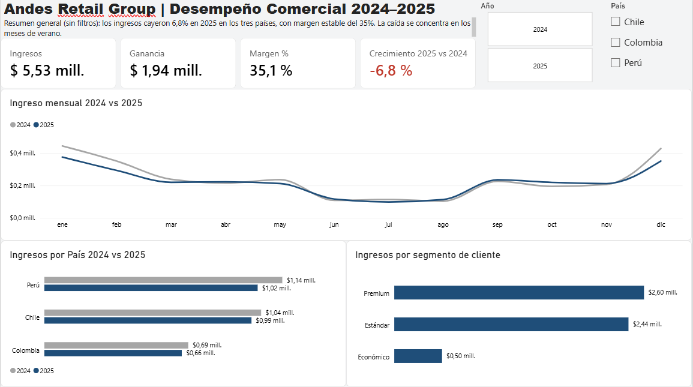
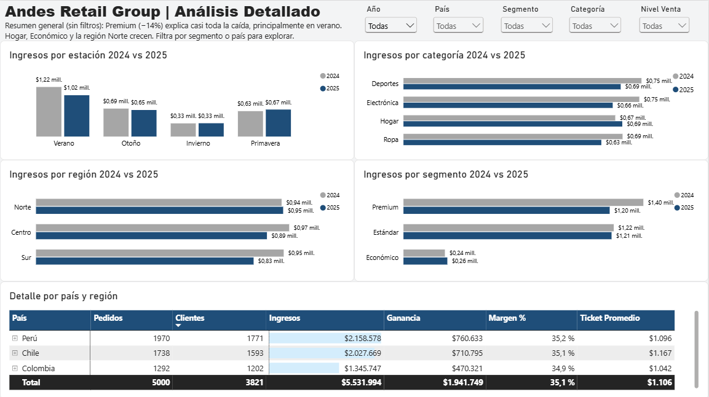

# 📊 Dashboard de Desempeño Comercial | Andes Retail Group (Power BI)

Dashboard interactivo en **Power BI** para analizar el desempeño comercial 2024–2025 de **Andes Retail Group**, una empresa de retail (ficticia) con operaciones en **Perú, Chile y Colombia** y cuatro categorías de producto: Electrónica, Ropa, Deportes y Hogar.

El objetivo es transformar datos transaccionales en información visual, clara y accionable para la dirección ejecutiva, y comunicar los hallazgos con el modelo de narrativa **SCQA**.



---

## 🎯 Preguntas de negocio

1. ¿Cómo ha evolucionado el ingreso total entre 2024 y 2025?
2. ¿Qué segmentos de clientes aportan mayor ingreso y rentabilidad?
3. ¿Qué categorías de producto tienen mayor impacto en el negocio?
4. ¿Existen diferencias relevantes entre países o regiones?
5. ¿Qué patrones temporales se observan a lo largo del año?
6. ¿Dónde podrían existir oportunidades de mejora comercial?

---

## 💡 Hallazgos principales

| Indicador | Resultado |
|---|---|
| Ingresos totales 2024–2025 | **$5,53 M** |
| Ganancia total | **$1,94 M** |
| Margen | **35,1 %** (estable en todos los cortes) |
| Crecimiento 2025 vs 2024 | **−6,8 %** ($2,86 M → $2,67 M) |

- **El problema es de volumen, no de rentabilidad:** el margen se mantiene en ~35 % en todos los segmentos, categorías, países y estaciones.
- **El segmento Premium explica casi toda la caída:** −14 % (−$196 K), con menos clientes (757 → 688) y un ticket promedio más bajo ($1.757 → $1.659).
- **La temporada alta es el foco:** el verano (dic–feb) concentra el 40 % del ingreso y cayó 17 %. Solo Premium en verano perdió $168 K, cerca del 86 % de la caída total.
- **Diferencias geográficas:** Perú (−10,4 %) y la región Sur (−12 %) son los más afectados; la región Norte se mantiene (+0,6 %).
- **Oportunidades:** Hogar es la única categoría que crece (+3,3 %), el segmento Económico sube (+5,9 %) y la primavera también creció.

### Recomendaciones

1. Campaña de retención y reactivación de clientes **Premium antes del verano** (nov–dic).
2. Plan comercial focalizado en **Perú y la región Sur**.
3. Impulsar **Hogar** como puerta de entrada para ventas cruzadas.
4. Adelantar campañas en **primavera** para reducir la dependencia del verano.

---

## 🖥️ Dashboard

### Vista 1: Overview Ejecutivo
*¿Cómo está el negocio en general?*

- KPIs: Ingresos, Ganancia, Margen % y Crecimiento 2025 vs 2024 (con formato condicional).
- Ingreso mensual 2024 vs 2025 (estacionalidad).
- Ingresos por país y por segmento de cliente.
- Filtros: Año y País.


### Vista 2: Análisis Detallado
*¿Dónde están las diferencias, patrones y oportunidades?*

- Ingresos 2024 vs 2025 por estación, categoría, región y segmento.
- Matriz de detalle por país y región: pedidos, clientes, ingresos, ganancia, margen y ticket promedio.
- Filtros: Año, País, Segmento, Categoría y Nivel de venta.



---

## 🛠️ Proceso

### 1. Exploración y validación de datos
- 5.000 pedidos (01/01/2024 – 31/12/2025), 12 columnas y 3.821 clientes únicos.
- Sin valores nulos ni pedidos duplicados; `Ingresos = Unidades × Precio` en el 100 % de las filas.

### 2. Preparación (Power Query)
- `Fecha_Pedido` con configuración regional Español (Latinoamérica) y tipos de datos corregidos.
- Columna condicional **`Nivel_Venta`**: "Venta Alta" si Ingresos ≥ 1.000, de lo contrario "Venta Baja". Las ventas altas son el 44 % de los pedidos pero el 72 % del ingreso.
- Columna **`Ganancia`** = Ingresos − Costo.

### 3. Modelo de datos
- Tabla **Calendario** (DAX) marcada como tabla de fechas y relacionada 1:* con la tabla de ventas.
- Medidas DAX:

```DAX
Ingresos Totales = SUM(Ventas[Ingresos])
Ganancia Total   = SUM(Ventas[Ganancia])
Margen %         = DIVIDE([Ganancia Total], [Ingresos Totales])
Pedidos          = COUNTROWS(Ventas)
Clientes Únicos  = DISTINCTCOUNT(Ventas[ID_Cliente])
Ticket Promedio  = DIVIDE([Ingresos Totales], [Pedidos])

Crecimiento YoY % =
VAR I2025 = CALCULATE([Ingresos Totales], Calendario[Año] = 2025)
VAR I2024 = CALCULATE([Ingresos Totales], Calendario[Año] = 2024)
RETURN DIVIDE(I2025 - I2024, I2024)
```

### 4. Principios de diseño
- Lectura en "Z", de lo general (KPIs) a lo específico (detalle).
- Paleta consistente: gris = 2024, azul = 2025, rojo solo para variaciones negativas.
- Etiquetas de datos en lugar de ejes y sin cuadrículas, para reducir ruido visual.
- Títulos descriptivos (sin conclusiones), para que sigan siendo válidos al aplicar filtros.

---

## 📝 Narrativa SCQA

**Situación:** Andes Retail Group generó $5,53 M en ingresos con un margen estable del 35 %, en un negocio muy estacional (picos en verano).

**Complicación:** en 2025 los ingresos cayeron 6,8 % en los tres países. La caída se concentra en el segmento Premium y en la temporada de verano.

**Pregunta:** ¿cómo recuperamos al cliente Premium en la temporada alta y qué oportunidades podemos aprovechar?

**Respuesta:** retener y reactivar clientes Premium antes del verano, priorizar Perú y la región Sur, e impulsar Hogar y la primavera como motores de crecimiento.

---

## 📁 Contenido del repositorio

| Archivo | Descripción |
|---|---|
| `proyecto9.pbix` | Archivo de Power BI Desktop con el modelo, las medidas y las dos vistas |
| `img/` | Capturas del dashboard |

Para explorarlo, descarga el archivo `.pbix` y ábrelo con [Power BI Desktop](https://www.microsoft.com/power-platform/products/power-bi/desktop) (gratuito).

---

## 🧰 Herramientas

Power BI Desktop · Power Query · DAX · Storytelling con datos (SCQA)

> Proyecto desarrollado como parte del programa de Data Analyst de TripleTen. Los datos son ficticios.
